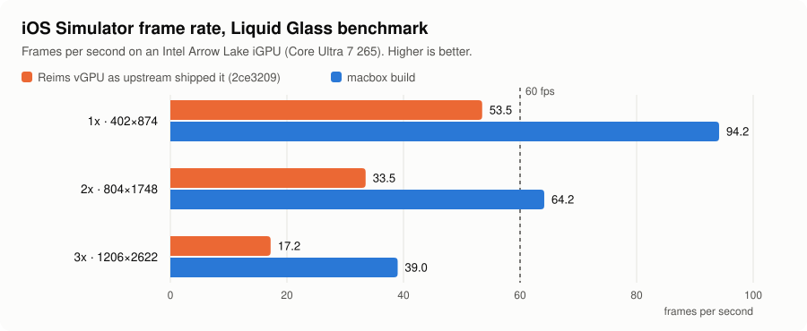

# macbox: macOS, Xcode and the iOS Simulator on Linux, GPU-accelerated, for AI coding agents

**Run the real iOS Simulator on a Linux machine, without a Mac and without a cloud service.**
macbox runs a full macOS VM in Docker with real GPU acceleration (Metal, through Reims vGPU on
your Vulkan GPU), with Xcode, a pool of iOS Simulators, T3 Code's Device panel, and the tools AI
coding agents (Claude Code, Codex, T3 Code) need to build, run, drive and check iOS apps on their
own. One command, `macbox`, sets it up and runs it.

**Website and guides:** [tuna-nope.github.io/macbox](https://tuna-nope.github.io/macbox/): macOS, Xcode and
the iOS Simulator on Linux, Expo apps, the GPU path, and AI coding agents with T3 Code.


<sub>macOS 26 Tahoe's desktop in macbox on an Intel iGPU, with two of its iOS 26.5 Simulators in front
(their screens composited onto the desktop's screenshot): GlassBench, a Liquid Glass load, and
Safari.</sub>

```
Linux host (KVM + a Vulkan GPU + Docker)
└─ container macbox
   └─ QEMU with Reims vGPU ──► metal2vulkan ──► Vulkan (Mesa) on your GPU
      └─ macOS 26 Tahoe (x86-64), drawn with Metal
         ├─ Xcode, CocoaPods, Node
         ├─ iOS Simulators: a pool, one per agent checkout (mac-sim)
         └─ T3 Code's device hub (Intel build)  ──► the Device panel, live
```

- **macOS draws on your GPU.** [Reims vGPU](https://github.com/steelbrain/reims-vgpu) gives QEMU
  Apple's paravirtual GPU, and macOS's own driver talks to it, so Metal works with no guest
  driver. [metal2vulkan](https://github.com/steelbrain/metal2vulkan) runs Metal's work on Vulkan.
  macbox builds both, with patches that roughly doubled the iOS Simulator's frame rate on the
  GPU it was measured on (see [Performance](#performance)).
- **The screen** opens in a window on your Linux desktop, or in a browser tab (Selkies: H.264 on
  the GPU, its bitrate following the link). Agents can see it and click and type into it
  (`macbox screenshot`, `click`, `type`), so an agent can drive the macOS installer too.
- **iOS Simulators for agents.** `mac-sim` gives each checkout its own simulator from a pool:
  slim ones for most work, a full one for widgets, Live Activities and the Dynamic Island, a
  sharp one for real-iPhone pixels. It builds the app on the Mac, runs Metro on the host,
  taps, types, takes lossless screenshots and records video. `sim-fps` checks that a recording
  held 60 fps with no dropped frames. A skill (`skills/simulators`) teaches Claude Code and Codex
  to use it after every UI change.
- **T3 Code.** `macbox t3 register` adds the VM to T3 Code's Device panel, and `macbox t3 fix-hub`
  rebuilds T3's device hub for Intel, so the panel streams the simulator live and takes taps.
- **Android too**, optionally: `android-sim` runs a pool of Android emulators on the host itself.

## What you need

| | |
|---|---|
| CPU | x86-64 with VT-x or AMD-V, and AVX2 |
| GPU | one with a Mesa Vulkan driver: **Intel** (measured: Arrow Lake iGPU) or **AMD** (supported by Reims, untested here). NVIDIA works with Reims but macbox's image doesn't ship NVIDIA's driver yet |
| RAM | 16 GB or more (the VM takes 8 to 16) |
| Disk | about 150 GB free, on an SSD or NVMe |
| OS | Linux with KVM (`/dev/kvm`), a render node (`/dev/dri/renderD*`), Docker (rootless is fine) or Podman |

macOS for Intel ends with macOS 26 Tahoe, and Apple ships iOS 27's simulators for Apple silicon
only. So macbox runs macOS 26, Xcode 26 and iOS 26 simulators, and that is the ceiling on x86-64.

## Quick start

```sh
git clone <this repo> macbox && cd macbox
./macbox init         # config in ~/.config/macbox/macbox.env, an SSH key, the ssh alias "macbox"
./macbox doctor       # checks KVM, the GPU, vm.max_map_count, Docker, disk space
./macbox build        # the image, then Reims vGPU + metal2vulkan + QEMU (20 to 60 minutes)
./macbox create       # a VM; macOS downloads from Apple
./macbox up           # then open http://127.0.0.1:6081/ (or: ./macbox view local)
./macbox next         # what's done and the next step, until everything is ticked
```

Installing macOS takes a few steps inside the VM: erase the disk and install, set Metal's error
mode once from Recovery, create a user, turn on SSH. `macbox next` prints each one, and
[docs/setup.md](docs/setup.md) walks through all of it. After that it's commands again:

```sh
./macbox provision                    # passwordless sudo, no sleep, Node, Ruby + CocoaPods, simslim...
./macbox xcode ~/Downloads/Xcode_26.6.xip   # Xcode and the iOS Simulator runtime
./macbox disk nvme                    # the system disk on NVMe (faster)
./macbox pool                         # the iOS Simulator pool
./macbox t3 register                  # T3 Code's Device panel (then: macbox t3 fix-hub)
./macbox agents install               # mac-sim, sim-fps, android-sim, the skills
```

Setting up with an agent: point it at [AGENTS.md](AGENTS.md).

## Performance

Measured on an Intel Core Ultra 7 265 (its Arrow Lake iGPU), Mesa 26.2.4, macOS 26.7.1,
iOS 26.5, 8 vCPUs and 12 GB. GlassBench is a table scrolling under Liquid Glass bars and a
floating glass toolbar, counted at the simulator's own screen (frames per second; two runs).

<picture>
  <source media="(prefers-color-scheme: dark)" srcset="docs/images/fps-dark.svg">
  
</picture>

| | Reims 2ce3209, as upstream shipped it on 2026-10-26 | macbox build |
|---|---|---|
| iOS Simulator 1x (402x874), glass | 53.5 | **95.8 / 92.5** |
| iOS Simulator 2x (804x1748), glass | 33.5 | **67.8 / 60.5** |
| iOS Simulator 3x (1206x2622, an iPhone's pixels), glass | 17.2 | **38.5 / 39.5** |
| Safari at 3x, a page with a blurred floating bar | n/a | 66.4 / 64.2 |
| macOS desktop, Genie minimize at 3440x1440 (frames per animation) | ~12 | 19.5 |

The GPU is the limit: a 3x simulator keeps this iGPU 96 to 98% busy. On a faster GPU every number
moves up. [docs/performance.md](docs/performance.md) has what the patches do, the method, what
didn't help, and the known limits (an idle macOS display gets no vblank from its driver, so an
animation starts about 0.1 s late: [reims-vgpu#141](https://github.com/steelbrain/reims-vgpu/issues/141)).

## Questions people ask

**Can I run the iOS Simulator on Linux?** Not by itself: it's part of Xcode, which needs macOS. macbox
runs macOS in a VM on Linux with the GPU attached, so the real Simulator runs on your own machine,
with no Mac, no cloud account and no per-minute bill.

**How do I give Claude Code or Codex an iOS Simulator on a Linux server?** Set up macbox, then
`macbox agents install`. Agents get `mac-sim` (a simulator per checkout: build, run, tap, screenshot,
record), `sim-fps` (did that animation hold 60 fps?), and a skill that tells them when and how to use
them. [docs/agents.md](docs/agents.md).

**Docker-OSX or OSX-KVM, but with GPU acceleration?** Those boot macOS in QEMU too, but macOS gets
Metal only when you pass a GPU it has drivers for through to the VM (VFIO), which takes that GPU
away from the host. Otherwise the desktop and the Simulator draw in software. macbox uses Reims vGPU
instead: Apple's own paravirtual GPU device, run on the host's Vulkan driver. The host keeps its GPU,
macOS gets Metal, and an integrated GPU is enough.

**Can I build and run an Expo or React Native iOS app on Linux?** Yes. `mac-sim run` copies the
checkout into macOS, builds it with Xcode and CocoaPods, and installs it in the simulator. Metro runs
on Linux, so JavaScript edits arrive by Fast Refresh. `MODE=release` gives a Release build, and
`MODE=go` opens the app in Expo Go.

**Does it work with T3 Code's Device panel?** Yes: the simulators stream live into the panel and take
taps ([docs/t3-code.md](docs/t3-code.md)).

**Real iPhones and TestFlight?** `phone-build` makes `.ipa` builds (EAS's free cloud builds first,
then locally in the VM) and uploads to TestFlight. Signing for devices needs Apple's paid Developer
Program ([skills/phone-builds](skills/phone-builds/SKILL.md)).

**What can't it do?** Run macOS 27, Xcode 27 or iOS 27's simulators, which Apple ships for Apple
silicon only. It also can't run macOS legally on non-Apple hardware (see below).

## How it compares

| | macbox | Docker-OSX, OSX-KVM | Cloud simulators | A Mac, or a remote Mac |
|---|---|---|---|---|
| Runs on | your Linux host | your Linux host | the provider's Macs | a Mac |
| Metal in macOS | yes, on the host's GPU through Vulkan | only with a GPU passed through to the VM | yes | yes |
| Cost | your hardware | your hardware | usually per minute or a plan | the Mac |
| Built for agents (a simulator per checkout, screenshots, recordings, a 60 fps check, a skill) | yes | no | varies | with tools such as agent-device |
| Newest iOS Simulator | 26.x (the x86-64 ceiling) | 26.x | the newest | the newest |
| Apple's macOS license | not on non-Apple hardware | not on non-Apple hardware | yes | yes |

## Docs

| | |
|---|---|
| [docs/setup.md](docs/setup.md) | a new install, step by step |
| [docs/architecture.md](docs/architecture.md) | how the parts fit: container, QEMU, display, network, guest, simulators, T3 |
| [docs/performance.md](docs/performance.md) | the GPU patches, measurements, tuning, limits |
| [docs/t3-code.md](docs/t3-code.md) | T3 Code's Device panel for iOS and Android |
| [docs/agents.md](docs/agents.md) | the agent tools, the skill, the instructions to give agents |
| [docs/troubleshooting.md](docs/troubleshooting.md) | when something doesn't work |
| [guest/README.md](guest/README.md) | what runs inside macOS |
| [patches/README.md](patches/README.md) | the patch series on Reims vGPU and metal2vulkan |
| [site/](site/README.md) | the website's source: the guides at https://tuna-nope.github.io/macbox/guides/ |

## Credits

macbox is glue and tuning around other people's work, above all Reims vGPU, metal2vulkan,
reims-util and their QEMU fork by Anees Iqbal ([steelbrain](https://github.com/steelbrain)).
[CREDITS.md](CREDITS.md) lists every project macbox builds, runs or downloads, and its license.

## License

macbox's own code and documents are under the
[PolyForm Noncommercial License 1.0.0](LICENSE). Use it, change it and share it for any noncommercial
purpose: yourself, a hobby, research, teaching, a school, a charity, a public body. **Commercial use
needs the author's permission**: open an issue to ask.

The patches in `patches/` modify Reims vGPU and metal2vulkan, and stay under those projects' terms,
`GPL-2.0-or-later OR LGPL-3.0-or-later` ([patches/README.md](patches/README.md)). Everything macbox
builds or downloads keeps its own license ([CREDITS.md](CREDITS.md)).

## Disclaimer

**macbox comes as is, with no warranty of any kind, and its authors accept no liability for anything
that comes of using it** (the license's "No Liability" section). It runs a virtual machine with
direct access to your GPU, and can lose the VM's data, for example with `MACBOX_DISK_CACHE=unsafe`
and a crash of the host.

macbox ships no Apple software. macOS, Xcode and the simulator runtimes download from Apple, under
Apple's terms, and **you alone are responsible for complying with them. Apple's software license
agreement for macOS allows it to run only on Apple-branded hardware; running it in a VM on other
hardware breaches that agreement.** macbox is not affiliated with, sponsored or endorsed by Apple Inc.
macOS, iOS, Xcode and Metal are trademarks of Apple Inc.
